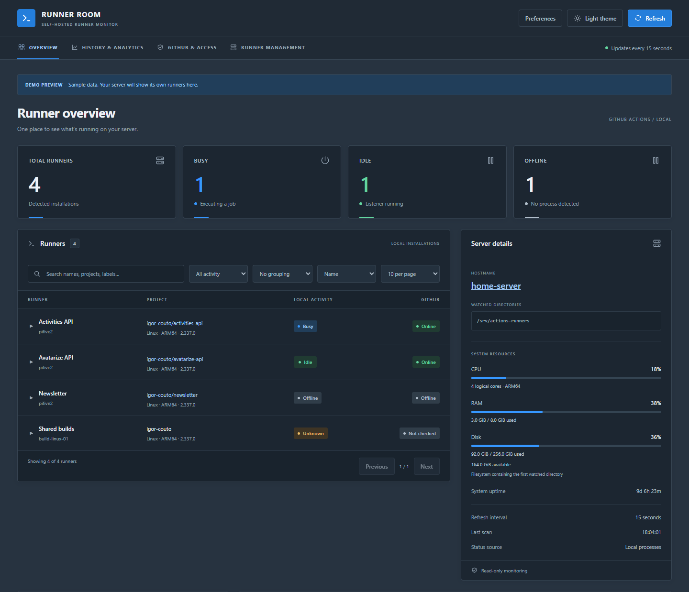

# Runner Room

[](https://github.com/igor-couto/github-self-hosted-runner-manager)


[](https://github.com/igor-couto/github-self-hosted-runner-manager/blob/main/LICENSE)

A dashboard for monitoring and managing GitHub Actions runners on your Linux server, including Raspberry Pi. Install it with one command and open it on your local network. Local monitoring works without a GitHub token.

[Install](#install) · [Support](#support) · [License](#license)



## Features

- **Runners and jobs:** live status, current jobs, searchable inventory, and diagnostic logs.
- **Server health:** CPU, memory, disks, network traffic, temperatures, and resource usage per runner.
- **History and alerts:** activity charts, job outcomes, CSV exports, and scheduled checks.
- **GitHub and management:** synchronize workflow activity; register, import, start, stop, drain, and update runners.
- **Your preferred view:** customizable widgets, themes, TV mode, an installable web app, CLI, and terminal dashboard.

Built with C# / ASP.NET Core and plain HTML, CSS, and JavaScript.

## Install

Requires **Linux with systemd and glibc**, on **x64, ARM32 (ARMv7+), or ARM64**. The .NET runtime is included; no SDK or Docker installation is needed.

Run this on your runner server, replacing `/srv/actions-runners` with the folder containing your runner installations (or a single runner folder):

```bash
curl -fsSL https://github.com/igor-couto/github-self-hosted-runner-manager/releases/latest/download/install.sh \
  | sudo bash -s -- --runners /srv/actions-runners
```

The installer selects the release for your architecture, verifies its checksum, and starts a service that runs after reboot. Open **`http://YOUR_SERVER_IP:8080`** on your local network.

The service uses the runner folder's owner by default. Add `--user YOUR_RUNNER_USER` if that folder is owned by root, or `--port 8090` to choose another port. See the [installation guide](docs/installation.md) for configuration, troubleshooting, and uninstalling.

Prefer containers? Follow the [Docker Compose or Helm guide](docs/deployment.md). Those deployments provide monitoring with read-only runner mounts; use the native installer for host runner management.

## Start using Runner Room

- **Monitor:** open Overview to see runners and server resources. Readings refresh every 15 seconds. Local process activity does not confirm connectivity to GitHub.
- **Connect GitHub:** follow the [synchronization guide](docs/github-sync.md) to add workflow history and GitHub status checks.
- **Manage runners:** open **Runner management → Set up management** to connect GitHub and choose permitted repositories. See [guided setup](docs/management-setup.md) for importing existing services.
- **Update:** open **Preferences → Application updates**. Older installations need one final installer run to enable this; see the [update guide](docs/application-updates.md).

Access is open to your trusted LAN by default. Optional [sign-in and roles](docs/access-control.md) let you restrict access.

## Documentation

| Guide | What you'll find |
| --- | --- |
| [Monitoring, history, and alerts](docs/monitoring.md) | Status meanings, logs, sensors, discovery settings, retention, and notifications |
| [Runner management](docs/runner-management.md) | Lifecycle actions, service permissions, recovery, pools, and maintenance |
| [Dashboard and other interfaces](docs/interfaces.md) | Layouts, themes, web app installation, CLI/TUI, and optional quota monitoring |
| [Configuration example](settings.example.json) | Available server settings |
| [Development and checks](docs/development.md) | Local setup, tests, and publishing releases |
| [Project structure](docs/architecture.md) | Code organization and build conventions |

## Try the demo or contribute

With the **.NET 9 SDK**, run from the repository root:

```bash
dotnet run --project src/RunnerRoom -- --Demo true --urls http://127.0.0.1:8080
```

Open `http://localhost:8080` to explore sample data without connecting to GitHub or changing your runners. A [Docker demo](docs/deployment.md#portable-demo) is also available.

Contributions are welcome. Read [CONTRIBUTING.md](CONTRIBUTING.md) and the [development guide](docs/development.md) to get started.

## Support

For help, contact **Igor Couto** at [igor.fcouto@gmail.com](mailto:igor.fcouto@gmail.com). Report bugs and suggest improvements through [GitHub Issues](https://github.com/igor-couto/github-self-hosted-runner-manager/issues). Please check existing issues before opening a new one.

For a bug report, include:

- Runner Room version, Linux distribution/version, and architecture (x64, ARM32, or ARM64).
- Relevant configuration, installation method, and steps to reproduce the problem.
- What you expected, what actually happened, and relevant screenshots or log excerpts.

Remove passwords, tokens, runner credentials, and other private information before sharing configuration, logs, or screenshots. Review diagnostic excerpts even when the dashboard has masked known secrets. **Report security vulnerabilities privately by email**, rather than in a public issue.

## License

Runner Room is available under the [MIT License](LICENSE).

## Author

* **Igor Couto** - [igor.fcouto@gmail.com](mailto:igor.fcouto@gmail.com)
