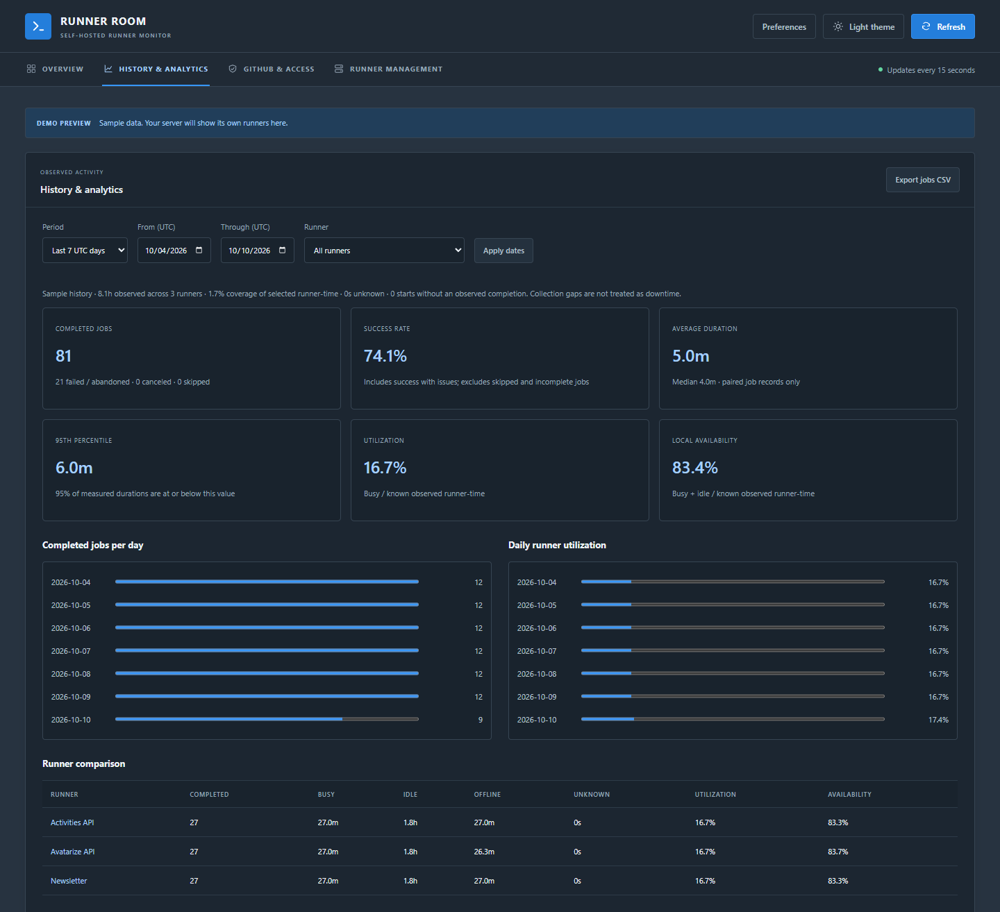

# Monitoring, history, and alerts

[Back to README](../README.md)

## What the status means

- **Busy:** a local `Runner.Worker` from that installation is running.
- **Idle:** its `Runner.Listener` is running with no visible worker, and process visibility is reliable.
- **Offline:** no matching process was found and process visibility is reliable.
- **Unknown:** permissions or process visibility prevent determining activity reliably.

**Local activity and GitHub connectivity are independent.** A listener can run while disconnected. The GitHub column reports Online/Offline only after an optional API check; otherwise it shows Not checked or Unknown. A failed API request never becomes Offline. API results are cached for up to 60 seconds, with their check time in the expanded details; local readings refresh every 15 seconds. Local activity is not overwritten by GitHub's potentially older busy flag.

Select a runner to expand its registered name, repository or organization scope, labels, machine, installed platform/version, process/PID/uptime, service name/state, last observed job and job activity time. Group by repository, organization/owner, machine, custom group, or registered runner group. Search includes display names, registered names, directories, projects, custom groups, machines, and GitHub labels.

Repository metadata and runner group come from `.runner`; the group is the locally recorded registration group, not a fresh GitHub group lookup. Platform comes from the runner's ELF executable; version comes from its assembly metadata or resolved `bin.VERSION`, never the installation folder's potentially outdated name. Uptime is the listener process age (or worker age if no listener is visible). Service state comes from a read-only `systemctl show`; unavailable systemd access shows Unknown, and runners without `.service` show Not configured. Missing metadata is explicitly unavailable.

For last-job information, the app reads only recognized job start/completion summary lines from the tails of up to five recent `_diag/Runner_*.log` files (256 KiB per file). Last activity means the most recent **recorded job event**, not a heartbeat or filesystem modification time. Old/rotated logs may leave this unavailable; an observed start without a completion does not prove the job is still running. Runner credential files and job workspaces are never exposed. Starting or stopping runners requires the separately enabled [management feature](runner-management.md).

## Current jobs and logs

Expand a runner to see its **Current job**: job name, workflow, repository, branch/ref, commit, triggering user/event, worker start time and elapsed time. Observed steps show running, succeeded, failed, skipped, canceled or unknown states and durations. A workflow link opens the complete run and job output on GitHub when a valid run ID is available. These features work locally **without a GitHub token**.

Current job details require a visible `Runner.Worker` process with a readable start time and a matching `_diag/Worker_YYYYMMDD-HHMMSS-utc.log`. A five-second startup tolerance matches the log to the process; an old job is never inferred merely from the newest file. The reader extracts only selected metadata from the first 1 MiB and recognized step events from the latest 256 KiB when the file grows larger. Earlier steps may be unavailable; the UI labels partial readings and does not invent a completion percentage or success result. Elapsed time is worker process age, which includes job setup. These diagnostic formats are internal to the [GitHub runner](https://github.com/actions/runner/blob/main/src/Runner.Worker/Worker.cs) and may change; missing metadata is shown as unavailable.

**View logs** opens a local diagnostic viewer for each runner, including idle/offline runners with retained logs:

- Choose from up to 20 recent listener/worker files, or follow the current job/latest file automatically.
- Refresh every 15 seconds, pause/resume, refresh manually, and optionally follow the newest lines.
- Search the loaded excerpt and filter warnings/errors.
- Download exactly the filtered, masked excerpt currently displayed.

This is a bounded diagnostic viewer, **not the full workflow console output**. Each response reads at most 256 KiB and returns at most 1,000 complete timestamped entries. It omits multiline continuations (including job payloads and stack-trace continuations), oversized entries and partially written final lines. File discovery examines at most 10,000 entries and returns the newest matching filenames within that scan. Rotation, deletion and permission errors show an unavailable state. Files are selected only from the discovered runner's `_diag` folder; arbitrary paths and symlinked files/folders are rejected.

Known GitHub token formats, the configured dashboard token, credential assignments and URL credentials/query strings are masked. **Masking is best effort:** diagnostics can contain other application data or secrets, so review before sharing. When authentication is enabled, diagnostic logs require an admin account; in open LAN mode anyone who can reach the dashboard can view them. Add custom exact strings to redact, or disable the viewer, in `/etc/runner-room/settings.json`:

```json
"Logs": {
  "Enabled": true,
  "RedactValues": []
}
```

Set `Enabled` to `false` to disable the log endpoint and viewer output. `RedactValues` also applies to current-job metadata and step names. Keep any file containing real redaction values private and out of Git; restart the service after configuration changes. No runner settings or files are modified.

## Richer inventory configuration

The original installer command still works. Advanced settings live in **`/etc/runner-room/settings.json`**, which the installer leaves untouched during updates. Create this file only if needed; start with [settings.example.json](../settings.example.json) and adjust every path. The service account must be able to read it. Restart `runner-room` after changes.

```json
{
  "RunnersRoots": ["/home/github-runner/actions-runner", "/srv/other-runners"],
  "Discovery": { "Recursive": true, "MaxDepth": 4 },
  "RunnerOverrides": [
    {
      "Path": "/home/github-runner/actions-runner/activities-api-arm64-2.322.0",
      "DisplayName": "Activities API",
      "Group": "APIs"
    }
  ]
}
```

- `RunnersRoots` replaces the legacy single `RunnersRoot` when nonempty. Overlapping roots are deduplicated. Every root needs read/traverse access for the service account; inaccessible roots generate a warning while readable roots still work.
- Default discovery checks immediate children, then the configured root itself when no child runners are found. This preserves the fix for stale parent registrations. Enable `Discovery.Recursive` to find installations at deeper levels; `MaxDepth` defaults to 4 and is capped at 16. Discovery stops inside recognized installations and excludes `_work`, `_diag`, hidden folders, binary directories, and child directory symlinks. A configured root may itself be a symlink. A 4096-directory limit bounds scans and produces a warning when reached.
- `RunnerOverrides.Path` is the full installation path. `DisplayName` and `Group` affect this dashboard only; they never change GitHub registration, labels, or runner files. Repeated registered names such as `pifive2` remain visible in the details.
- System disk readings refer to the **first readable root's filesystem**; they do not combine disks from all roots. Machine grouping currently groups installations on this one host, ready for a future multi-server feature.
- For development, pass `--SettingsFile /absolute/path/settings.json`. Explicitly selected missing/invalid files fail startup. Environment variables and command-line settings take precedence over JSON. Arrays can also be set using `RunnersRoots__0`, `RunnersRoots__1`, etc.

### Optional GitHub connectivity and labels

Local monitoring works without a token. To enable GitHub checks, create a fine-grained personal access token for the relevant repository owner with **repository Administration: Read** for repository runners, or **organization Self-hosted runners: Read** for organization runners. The account must have the access GitHub requires for these endpoints. See [GitHub's runner API permissions](https://docs.github.com/en/rest/actions/self-hosted-runners).

Store the token alone in `/etc/runner-room/github.token`, readable only by root and the dashboard's service account (for example root-owned, the service account's private group, mode `640`). Add this property to `settings.json` and restart the service:

```json
"GitHub": { "TokenFile": "/etc/runner-room/github.token" }
```

Alternatively use the `GitHub__Token` environment variable. Never put real tokens in source control. The backend sends the token only to `https://api.github.com`, rejects redirects, and matches registrations by scope and runner ID rather than name. GitHub Enterprise hosts are not supported by this optional integration yet. Requests have bounded concurrency/timeouts; inaccessible registrations, permission errors, and rate limits show Unknown with an explanation. The token is never sent to the browser. The credential must cover all configured scopes; scopes it cannot access continue to show local information. GitHub App installation credentials are also supported; see the [synchronization guide](github-sync.md).

Re-running the installer with setup arguments rewrites its environment file; updates started from Preferences preserve it. Separate JSON/token files remain the recommended persistent configuration.

## System information

The **System resources** section inside Server details shows:

- **CPU:** utilization across logical cores between scans, plus core count and architecture. The first reading says Sampling until another scan is available.
- **RAM:** total usable memory minus available memory, so reclaimable caches are not counted as used RAM.
- **Disk:** used, total, and available space on the filesystem containing the watched runner directory, including a separate drive or a symlinked path. This is filesystem usage, not the size of the runner folders. Available space excludes blocks reserved by the filesystem.
- **System uptime:** time since the Linux system booted.

Memory, CPU, and uptime come from Linux's [system information files](https://docs.kernel.org/filesystems/proc.html); disk capacity comes from .NET's filesystem APIs. Readings use binary units (GiB, MiB). Missing or inaccessible measurements show Unavailable and do not prevent runner monitoring. No extra permissions or tools are required by the installer.

Install directly on the Linux runner host for host readings. In a development container, readings reflect the Linux environment visible to that container, not container resource limits or the Windows/macOS host. Demo mode uses sample system metrics as well as sample runners.

### Detailed system monitoring

The **Detailed system monitoring** panel adds six views. Expand a runner to see its resource summary next to the job details.

| View | Readings |
| --- | --- |
| CPU & memory | Per-core utilization, 1/5/15-minute load averages, swap used/total. No swap is shown as Not configured. |
| Network | Upload/download bytes per second for every visible interface, observed daily received/sent totals and coverage time in UTC. |
| Storage | Read/write rates and busy time for whole block devices; capacity, available space and hourly growth graphs for multiple filesystems. |
| Hardware | Readable CPU/SoC/other temperature sensors, thermal throttle counters, supported Raspberry Pi power indicators, battery status/charge/energy/power. |
| Processes | Top 20 processes by CPU or RAM, or application groups based on executable name. |
| Runner resources | CPU/RAM and process counts for each listener, worker and visible descendants, plus workspace sizes. |

A background collector samples every **15 seconds even when the page is closed**. HTTP requests read its most recent snapshot, so workspace scans do not block dashboard requests. Missing readings are unavailable; CPU and traffic rates need two samples. Network/disk counters that reset, and traffic intervals longer than 60 seconds, establish a new baseline. Readings older than 45 seconds are labelled stale.

Network totals are **observed traffic**, not reconstructed full-day usage. Collection starts at zero on first observation, resumes saved daily totals after restart, and excludes downtime and the sample crossing UTC midnight. Per-interface coverage records the seconds actually counted. Interfaces and stacked storage devices are never summed, avoiding double-counting bridge/container traffic or LVM activity. Disk sector counters use Linux's fixed 512-byte accounting units. The [kernel network](https://docs.kernel.org/networking/statistics.html) and [disk I/O](https://docs.kernel.org/admin-guide/iostats.html) documentation describe these counters.

Process CPU uses **one core = 100%**, so a multithreaded process or group can exceed 100%. PID/start-time matching prevents reused PIDs from inheriting old CPU deltas. RAM is summed resident memory (RSS), which can double-count shared pages. Processes that finish between samples are not retained. Hidden processes, reparented/detached jobs, and work started by a container daemon may be absent from runner totals. No process command lines, environment variables or file contents are collected. Grouping by executable name is a heuristic: separate applications using `dotnet`, `node` or `java` can share a group.

Filesystem discovery includes `/`, common local disk formats, and mounts containing configured runner roots. Bind mounts with the same device and filesystem root are deduplicated. Add extra mount paths with `Monitoring.FileSystems` (for example `/mnt/backups`); unusual filesystems and network mounts can be included this way. History is tracked by device and filesystem root; moving/replacing volumes can start a new series. Up to 64 filesystems and block devices are returned. Graphs begin with real measurements, stored hourly; they do not fabricate pre-installation history.

Workspace discovery honors `.runner`'s `workFolder`, defaulting to `_work`. Scans run every five minutes by default, count logical file sizes, and skip symlinks and nested mounts. Each scan is limited to 50,000 entries, 32 levels and approximately 250 ms, with a three-second budget across runners. An inaccessible directory, excluded link/mount or exhausted budget produces a **partial lower bound**, not a complete size. Hard-linked files can be counted more than once; sparse-file logical sizes can exceed allocated disk usage. A slow underlying filesystem operation can delay collection; the page keeps the last snapshot and indicates staleness.

Hardware support depends on Linux drivers and service-account access. Temperatures use thermal/hwmon sensors; batteries use the [power supply class](https://docs.kernel.org/power/power_supply_class.html). Cumulative thermal event counts do not imply active throttling. If installed and accessible, `/usr/bin/vcgencmd` or `/opt/vc/bin/vcgencmd` is queried with `get_throttled` and a one-second timeout. Firmware current flags and historical latches are displayed separately. Latches can be cleared by other tools/drivers. The kernel `rpi_volt` fallback reports a recent undervoltage alarm, not instantaneous voltage or lifetime history. No privileges are elevated and no hardware settings are changed.

### Monitoring history and configuration

The installer now gives the service a private **`/var/lib/runner-room`** state directory. Daily traffic and hourly storage history are saved atomically to `monitoring.json` at most once per minute and on graceful shutdown. Updates preserve this directory. A crash can lose the most recent unsaved minute. If the directory is not writable, collection continues in memory and displays a warning. Re-run the installer when updating an older service to apply the new state-directory setting.

Optional settings in `/etc/runner-room/settings.json`:

```json
"Monitoring": {
  "HistoryDays": 7,
  "WorkspaceScanMinutes": 5,
  "FileSystems": ["/mnt/backups"]
}
```

Retention is configurable from 1–30 days and workspace intervals from 1–60 minutes. At most 64 filesystem histories and 8,000 interface/day records are retained. For a manual/development installation, `Monitoring.StateDirectory` can select a writable directory; under systemd any custom location must also be writable within its sandbox. The default uses systemd's `STATE_DIRECTORY`, `/var/lib/runner-room` on other Linux launches, or the current account's local application data directory on Windows. Demo mode writes no monitoring history. Windows is useful for the demo; live collection targets Linux.

## History and analytics



The **History & analytics** panel records runner activity in the background every 15 seconds, even while the dashboard is closed. It provides:

- Job history with outcomes, start/completion times and measured durations.
- Completed jobs, success rate, average/median duration and 95th-percentile duration.
- Busy, idle, offline and unknown time per runner, with utilization and local availability.
- Daily completed-job and utilization charts, runner comparisons, date and runner filters.
- Outcome filtering, 50-row pagination and CSV export of **all** matching jobs.

Date filters and daily buckets use **UTC**; timestamps in the job table use your browser's local time. Outcome filters affect the job table and CSV only. Success rate includes success with issues and excludes skipped/incomplete jobs. Canceled and abandoned jobs count as unsuccessful. Duration statistics use only matched start/end records; the 95th percentile uses the nearest-rank method.

Utilization is busy time divided by observed busy + idle + offline time. Local availability is busy + idle time divided by that same denominator; it does not measure connectivity to GitHub. Unknown states and collection gaps are excluded from both percentages. Coverage includes unknown observations and is measured against the selected interval across all selected retained runners, including time before a runner was discovered. Sampling gaps longer than 45 seconds and gaps across restarts are not filled in. Brief activity between samples may be missed.

Recent local listener summaries are imported automatically: up to five listener files among the 20 most recent diagnostic files, with at most the final 256 KiB read per file. This is not a complete GitHub workflow history. Rotated/deleted logs and incomplete records can leave outcomes or durations unavailable. Durations require a matching start and completion in the same imported excerpt; starts without a completion remain incomplete. Repeated imports are deduplicated. Only redacted job names, outcomes, timestamps, runner names/repositories and aggregated activity are persisted, never raw logs. Configured log redaction applies when importing metadata.

History is saved atomically to **`analytics.json`** in the same state directory as system monitoring, once per minute and on graceful shutdown. Installer updates preserve it. A crash may lose the most recent unsaved minute; an unwritable directory produces a visible warning and collection continues in memory. If a saved file is corrupt or incompatible, it is preserved: back it up, remove it and restart the service to restore persistence. Demo history is isolated and never saved.

Default retention is 30 UTC calendar days, including today. Configure `Analytics.RetentionDays` from 1–90 in settings, or `Analytics__RetentionDays` in the service environment. Capacity is bounded to 20,000 job events and 50,000 runner/hour records; reaching these limits removes the oldest data and shows a warning. Changes require a service restart. No GitHub token is needed.

## Alerts and scheduled checks

The **Alerts & scheduled checks** panel shows active incidents, recovered alerts, configured rules, unavailable readings and the next scheduled check. Checks run automatically every **60 seconds**, including while the page is closed. **Check now** requests an extra check; requests are limited to one per ten seconds and never overlap an ongoing check. The dashboard still refreshes every 15 seconds. Checks inspect local data; they never start, stop or restart runners.

Default rules:

| Condition | Threshold | Must remain observed for |
| --- | --- | --- |
| Runner offline | No local listener/worker process | 120 seconds |
| Long-running job | Worker age ≥ 60 minutes | 120 seconds |
| Repeated job failures | ≥ 3 failed/abandoned jobs in the last 15 minutes | Immediate |
| CPU / RAM usage | ≥ 90% | 120 seconds |
| Disk usage | ≥ 90% per monitored filesystem | 120 seconds |
| Temperature | Hottest available CPU/system sensor ≥ 80°C | 120 seconds |
| Monitoring unavailable | Runner or detailed system snapshot missing/stale | 120 seconds |

Unknown readings never resolve existing alerts. A missing runner or filesystem becomes **unconfirmed**, and missing data resets a pending condition's delay. A gap longer than twice the check interval plus ten seconds also resets pending delays. Sustained conditions are inferred from consecutive checks; brief changes between samples may be missed. Disabled/edited rules retire their existing incidents without claiming recovery. On restart, active incidents are revalidated before notifications resume. Pending delays restart from zero. Failure alerts depend on available local job summaries, not complete GitHub workflow history.

Configure the following in `/etc/runner-room/settings.json` and restart the service:

```json
"Alerts": {
  "Enabled": true,
  "CheckIntervalSeconds": 60,
  "RepeatMinutes": 60,
  "RetentionDays": 30,
  "QuietHoursStartUtc": "22:00",
  "QuietHoursEndUtc": "07:00",
  "WebhookUrlFile": "/etc/runner-room/alerts-webhook.url",
  "Rules": [
    { "Id": "offline", "Kind": "runner-offline", "HoldSeconds": 120 },
    { "Id": "build-duration", "Kind": "job-duration", "Threshold": 45, "HoldSeconds": 60, "Target": "build-one" },
    { "Id": "disk", "Kind": "disk", "Threshold": 90, "HoldSeconds": 120, "Severity": "critical", "Target": "/" }
  ]
}
```

Omit `Rules` or leave it empty for all default rules; a nonempty list replaces the defaults. Supported kinds are `runner-offline`, `job-duration`, `job-failures`, `cpu`, `memory`, `disk`, `temperature` and `monitor-unavailable`. IDs must be unique lowercase letters/digits/hyphens. Severity is `warning` (default) or `critical`. `Target` optionally matches a runner's folder name/absolute path for runner rules or an exact mount path for disk rules; other rules are host-wide. Invalid or duplicate rules are skipped with a visible warning. Up to 32 rules are supported. Check intervals are clamped to 15–3600 seconds, retention to 1–90 days, and repeat intervals to 0–10080 minutes. Zero repeats disables reminders. Hold delays range from 0–86400 seconds.

**Notifications are dashboard-only by default.** Optionally put a generic HTTPS webhook destination in `WebhookUrlFile`, readable by the service account (for example, owner `github-runner`, mode `600`). Alternatively set `Alerts__WebhookUrl` in the service environment. Destination URLs are never returned by the API. Delivery uses JSON POSTs with `source`, `incidentId`, `state`, `rule`, `severity`, `title`, `detail`, `firedAt` and `resolvedAt`. This generic payload requires a compatible receiver or a translation service; it is not a native Slack/Discord/email adapter. Redirects are not followed, and requests time out after five seconds. Delivery is limited to ten queued incidents per check. No external notifications are sent in demo mode.

Each incident sends an initial notification, optional reminders while still firing, and recovery if the initial notification was delivered. Failed sends retry after five minutes. Delivery is best-effort with possible duplicates if the service stops after sending but before saving; receivers can deduplicate by incident ID and state (while allowing reminders if desired). Recovery before any successful delivery cancels the pending initial notification. Quiet hours use UTC, may cross midnight, and pause external delivery while checks and recording continue. Invalid quiet-hour settings pause external delivery with a warning. Remove both quiet-hour values to disable the window. There is no runner maintenance or workflow scheduling.

Alert state and delivery markers are saved atomically after checks to `alerts.json` in the monitoring state directory. Installer updates preserve this file. Up to 500 active incidents and 2,000 total records are retained; the dashboard returns the latest 200 closed incidents. Unwritable storage falls back to memory with a warning. Corrupt saved files are preserved; back up and remove the file, then restart to restore persistence. In open LAN mode, anyone who can reach the dashboard can view alerts and request checks. With authentication enabled, requesting checks requires an admin account; notification destinations and rules can only be changed in server configuration.
